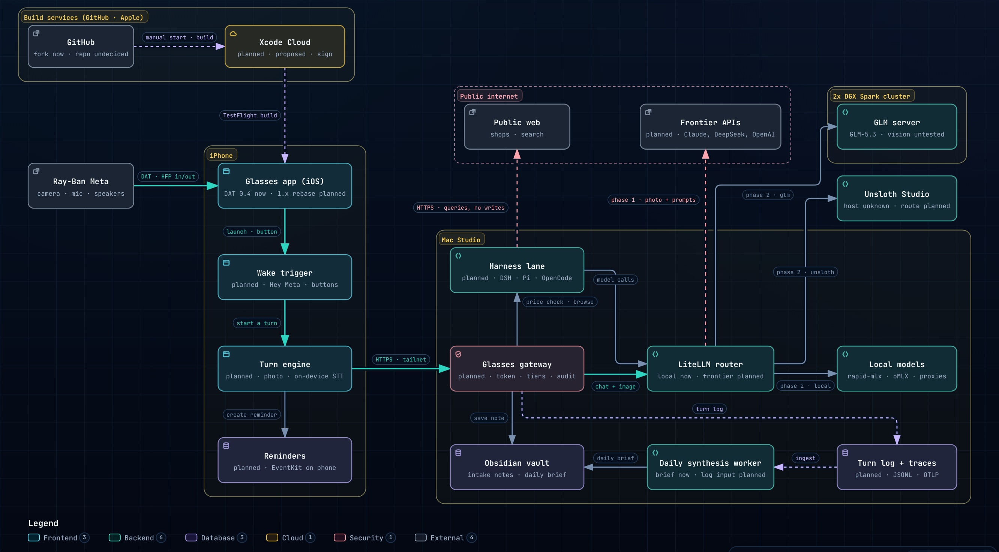

# Glasses assistant architecture map

Two authored models, the pages Archify rendered from them, and the record of the review they went through.



| File | What it is |
|---|---|
| `base.json` | The system as found: an older fork of the app calling four vendor clouds from the phone, and models on the Mac and the DGX pair that no path was found to. It cites the fork's source at commit `73c5318` |
| `head.json` | The target: a trigger and photo turn on the phone, a gateway on the Mac, frontier APIs first and local models second, a harness lane for Mac-side tasks, and the evidence trail into the vault |
| `glasses-assistant.html` | The target, rendered by Archify 3.2 with all four gates passing |
| `glasses-assistant.base.html` | The as-found system, rendered the same way |
| `glasses-assistant.delta.html` | Before, Delta and After in one page, with the exact authored changes |
| `*.finalize-summary.json`, `*.finalize.json`, `*.browser-check.json`, `*.delivery.json` | Gate receipts for the two rendered models |
| `glasses-assistant.delta.receipt.json` | The comparison's receipt: what was compared, by semantic hash, and the change counts |
| `review/` | The review record, round by round; two captures; the hashes of the pages the reviewers saw |

Open the HTML files in a browser. They work offline. GitHub shows their source, not the page, so download them or open them from a checkout.

Both models are Archify `architecture` IR, schema version 1, `signal-flow` preset, `showcase` profile. Component and relationship ids are stable; keep them stable so the delta stays meaningful, and give a different thing a different id.

## Reading the target

- **One turn.** A trigger starts it. The phone takes one photo from the glasses and one spoken question, transcribes the question itself, and sends image plus transcript to the gateway on the Mac. The answer returns on the same request and is spoken. The thick teal line is that path.
- **Two kinds of call out of the private network.** The router's calls to the frontier APIs in phase 1, carrying the photo, the question and a harness's prompts, and the harness lane's search queries and page reads. Both leave from the Mac and both are the pink dashed lines. The phone talks to the gateway only. What the platforms do on their own (Meta's assistant, iCloud, vault sync) is not drawn and was not checked.
- **Frontier first, then local.** A route moves to a local model only when it matches the frontier baseline on the eval set, and the frontier routes are kept. Switching is meant to be a route change in LiteLLM; that is a design intent which `M0-04` and `M0-06` test.
- **Evidence.** The gateway writes a turn log and traces. The daily synthesis worker already writes the daily brief into the vault; it gains one input.
- **Planned means planned.** A sublabel that starts with `planned` marks something not built or not wired. "X now · Y planned" marks something that exists and gains a planned part. Tag `configured` marks something that exists according to a record (the operator's log or word, or source that was read) and was not seen running. Nothing on the Mac or the DGX pair was probed.
- **Unsloth Studio sits outside every frame.** It is installed per the operator; which machine it runs on is question O-3 in the plan.

## How these were produced

1. The models were written by hand from the plan.
2. Archify's `finalize` ran on each model: validate, deliver, check, browser check. A failed gate was repaired in the model (positions, label placement) and the full command run again. No component, relationship or label was dropped to pass a gate. The as-found model cites source lines in this repository at commit `73c5318`, and the tool checked them.
3. Archify's `compare` produced the delta page and its receipt.
4. Three read-only reviewers looked at captures in dark, light, 2x and phone width through three lenses: legibility, meaning, conformance to the checklist. A separate pass checked serious findings against the files before they were acted on. Confirmed findings were fixed in the models and steps 2 and 3 run again. This ran three times; `review/round-1.md`, `round-2.md` and `round-3.md` say what was found and what was done each time. The changes made after the third round were checked by the gates and by the author, not by a fourth set of reviewers.

The first render passed every gate and still drew eight planned components as if they were live. The review caught it. That is why the standard this map follows counts a review as part of delivery.

The renders were made in a scratch working directory and copied here, so paths inside the receipts point at that directory. The hashes in the receipts and in `review/pages.sha256.json` identify the models and pages regardless of path. Re-rendering on your own machine rewrites the receipts with local paths.

## Known limits

These belong to the renderer, not the models. Three review rounds judged each acceptable as long as it is stated.

- **Comparison view, markers and frames.** Change markers (`+`, `~`) print over the small status tags and sometimes inside a box. A boundary whose members changed is drawn a second time, as the earlier frame with its own title.
- **Comparison view, colour.** In the Delta tab line colour shows the kind of change, so both exits are green like every added line. Read the exits from the After tab, or from their pink labels and arrowheads.
- **Comparison view, size.** The drawing is fitted to the window's height: about 0.8 scale in a 900px-high window, which puts relationship labels near 6.5px. Zoom, or read detail in the Before and After tabs.
- **Comparison view, theme and checks.** The page shows a theme button and has no light theme, and its description is the target's. Archify's `visual-check`, which is written for a single map, fails on it for the missing theme and because the page scrolls vertically (4 `viewer/theme-state` and 6 `viewer/viewport-overflow` diagnostics). It passes on the target and as-found pages. The comparison's own receipt passes 28 of 28 checks.
- **The tool's review field.** Archify records `visualReview` as "not-requested" on the two finalize receipts and "pending" on its visual-check records. The review recorded in `review/` was done by separate reviewers, outside the tool.
- **Light theme.** Grey relationship labels are about 3.1:1 against the background. No fact is carried only on a grey label.
- **Phone.** The cards read well; the map has to be zoomed and panned. At 400px the zoom control is clipped, so pinch to zoom.
- **One advisory, accepted.** The route from the router to the GLM server takes three bends so that it stays out of the Public internet frame. The tool notes it (`inspect-route-readability`).

## Re-rendering

With the `visual-standard` skill installed, from the repository root:

```bash
ARCHIFY_DIR=<archify> sh <visual-standard>/scripts/render.sh docs/architecture/glasses-assistant --captures
```

Or by hand. Replace `<archify>` with the installed Archify skill directory.

```bash
node <archify>/bin/archify.mjs finalize architecture \
  docs/architecture/glasses-assistant/head.json \
  docs/architecture/glasses-assistant/glasses-assistant.html \
  --quality showcase --json --repo-root .

node <archify>/bin/archify.mjs finalize architecture \
  docs/architecture/glasses-assistant/base.json \
  docs/architecture/glasses-assistant/glasses-assistant.base.html \
  --quality showcase --json --repo-root .

node <archify>/bin/archify.mjs compare architecture \
  docs/architecture/glasses-assistant/base.json \
  docs/architecture/glasses-assistant/head.json \
  docs/architecture/glasses-assistant/glasses-assistant.delta.html \
  --receipt docs/architecture/glasses-assistant/glasses-assistant.delta.receipt.json \
  --quality showcase --json --repo-root .
```

A non-zero exit is not success. Read the diagnostics, repair the model, and run the same command again. Archify refuses to overwrite the browser receipt of an earlier render, so remove the previous page and its receipts first; the script does that for you.

`--repo-root` is needed because both models pin this repository at commit `73c5318` and cite source lines there; that commit must be present in the checkout.

## Updating the map as the build moves

1. Copy `head.json` over `base.json`. Keep `meta.repository` in both models or in neither, and keep at least one cited source wherever it is set.
2. Edit `head.json`. When something is built, drop `planned · ` from its sublabel and change its tag: `live` when you saw it work, `configured` when it is set up and unproven, `blocked` when a gate holds it. Add or remove relationships as they become real.
3. Render, look at the captures, and run a review round if anything moved.
4. Append one ledger line naming what changed and the receipt path.

Do this at the end of each milestone, not for every commit.
